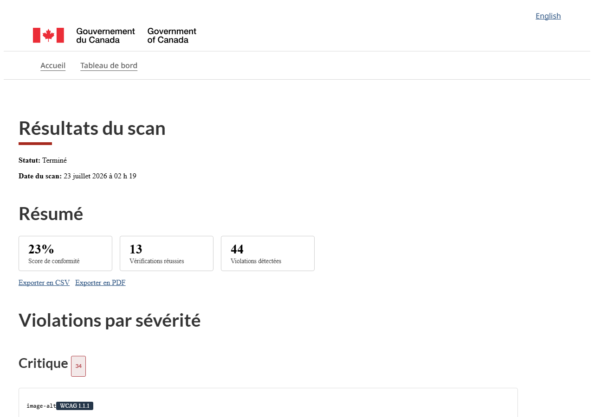
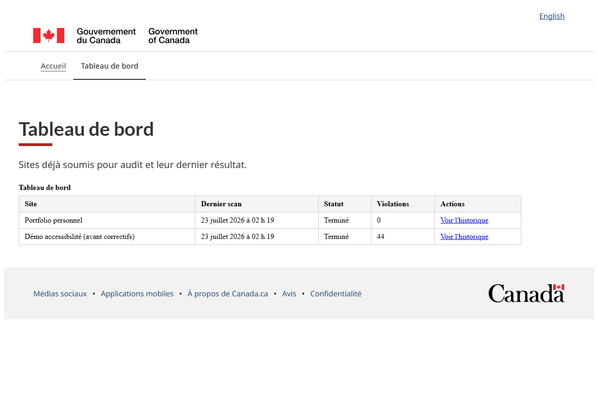
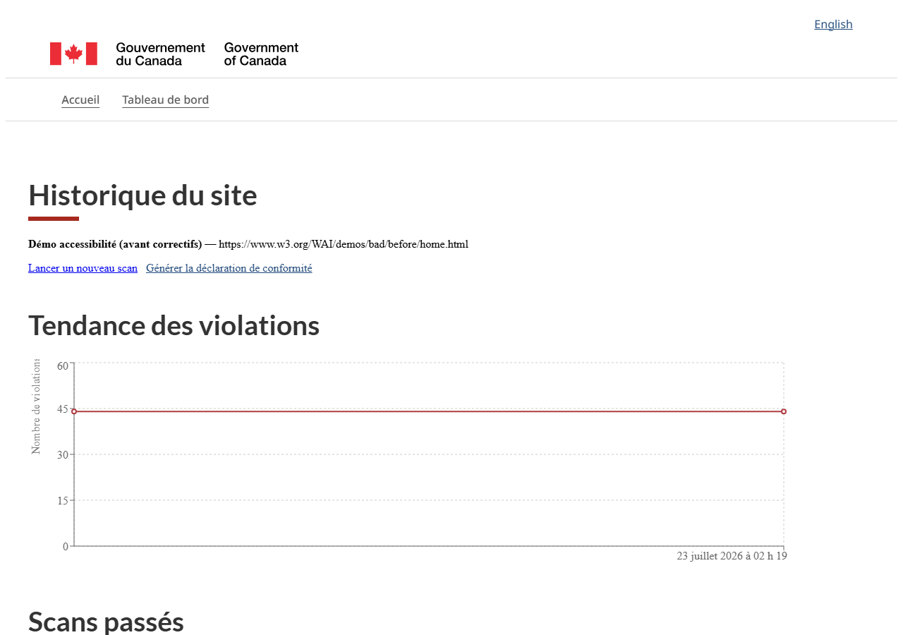
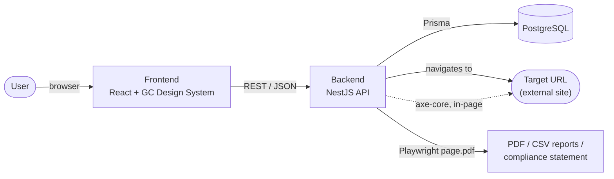

# WCAG Accessibility Auditor

[La version française est le fichier README.md.](./README.md)

A web tool that audits a public URL's accessibility against the Web Content Accessibility Guidelines (WCAG) 2.1, level AA, keeps a history of scans, and presents results in a fully bilingual (French/English) dashboard.

This project is a technical portfolio piece by [Gween Kangah](https://gweenkangah.pro) ([@itsGween](https://github.com/itsGween)), a Collège La Cité graduate in computer engineering technology, applying to IT/CS positions with the Canadian federal government. It aims to demonstrate a genuine understanding of Government of Canada digital standards — the [GC Design System](https://design-system.canada.ca/), real bilingualism, and a compliance statement in the format of a real government accessibility statement — as much as a complete end-to-end feature set.

## Preview

**Scan results**, with violations grouped by severity and WCAG criterion:



**Dashboard** of previously audited sites:



**Site history**, with violation trend over time:



## Features

- Submit a public URL through an accessible form (GC Design System components)
- Real page scanning (headless Playwright browser + axe-core rules engine), not a plain static HTML fetch
- Categorization of every violation: axe-core rule, impact level, WCAG 2.1 criterion/criteria, offending HTML snippet, CSS selector
- Dashboard of past scans, with a summary conformity score
- Per-site history and a violation-count trend chart
- Export a scan report as **PDF** and **CSV**
- Generate a **compliance statement** in the format of a government accessibility statement (methodology, scope, known limitations, date)
- **Fully bilingual** FR/EN interface, with duplicated content (not just translated labels) and a distinct URL per language (`/fr/...`, `/en/...`)
- SSRF protection: only http/https URLs resolving to a public address can be scanned

## Architecture



| Component | Technology |
|---|---|
| Frontend | React 18, strict TypeScript, Vite, GC Design System, react-i18next, React Router, Recharts |
| Backend | NestJS, strict TypeScript, Prisma, PostgreSQL |
| Scan engine | Playwright (headless Chromium) + `@axe-core/playwright` |
| Reports | Playwright (`page.pdf()`) for PDF, custom CSV generation |
| Infra | Docker / docker-compose, GitHub Actions |

See the [documented architecture decisions (ADRs)](docs/adr/) for the detailed reasoning behind these choices.

## Installation

### With Docker (recommended)

```
cp .env.example .env
docker compose up -d --build
```

- Frontend: http://localhost:5173
- API: http://localhost:3000 (interactive OpenAPI docs at `/api/docs`)

### Local development

Prerequisites: Node.js 20+, Docker (for PostgreSQL).

```
cp .env.example .env
docker compose up -d postgres

cd backend
npm install
npx playwright install --with-deps chromium
npm run prisma:migrate
npm run start:dev
```

In a second terminal:

```
cd frontend
npm install
npm run dev
```

See [CONTRIBUTING.md](CONTRIBUTING.md) for full setup instructions and the contribution workflow.

## Tests

```
cd backend
npm test
```

Unit tests cover the categorization logic (axe-core rule → WCAG criterion mapping) and SSRF protection in particular — see `backend/src/scan/*.spec.ts`.

## Documentation

- [OpenAPI documentation](docs/openapi.yaml) (generated from `@nestjs/swagger` decorators; interactive UI at `/api/docs` once the API is running)
- [Architecture decisions (ADRs)](docs/adr/)
- [This project's accessibility statement](ACCESSIBILITY_STATEMENT.md)
- [Security policy](SECURITY.md)
- [Contributing guide](CONTRIBUTING.md)
- [Code of conduct](CODE_OF_CONDUCT.md)

## Roadmap

Out of scope for this MVP, documented here rather than built prematurely:

- Multi-user authentication and RBAC (covered in depth by the next portfolio project, *SecureGate*)
- Automatic crawling of an entire site or sitemap
- Async job queue for large-scale concurrent scans
- Before/after comparison between two scans
- Email or webhook notifications

## License

[MIT](LICENSE)
