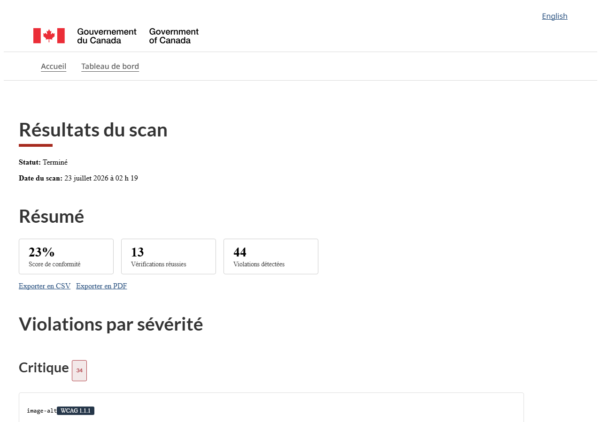
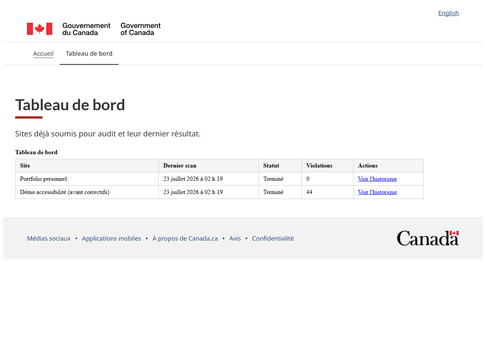
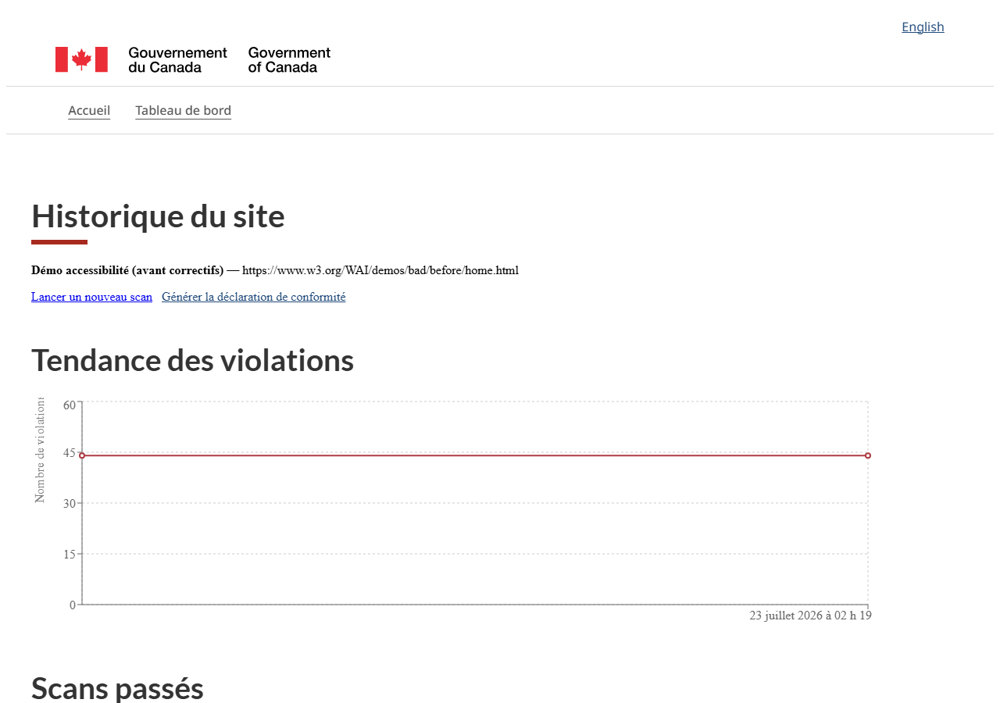
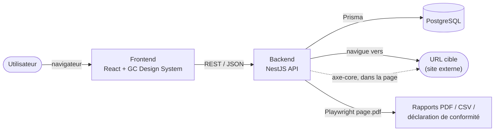

# Auditeur d'accessibilité WCAG

[The English version follows.](./README.en.md)

Un outil web qui audite l'accessibilité d'une URL publique selon les Règles pour l'accessibilité des contenus Web (WCAG) 2.1, niveau AA, conserve l'historique des scans, et présente les résultats dans un tableau de bord entièrement bilingue (français/anglais).

Ce projet est une pièce de portfolio technique de [Gween Kangah](https://gweenkangah.pro) ([@itsGween](https://github.com/itsGween)), diplômée en génie des technologies informatiques (Collège La Cité, Ottawa), candidate à des postes IT/CS au gouvernement fédéral canadien. Il vise à démontrer une compréhension réelle des normes numériques du gouvernement du Canada — le [GC Design System](https://design-system.canada.ca/), le bilinguisme réel, et une déclaration de conformité au format d'une vraie déclaration d'accessibilité gouvernementale — autant qu'une fonctionnalité complète de bout en bout.

## Aperçu

**Résultats d'un scan**, avec violations groupées par sévérité et critère WCAG :



**Tableau de bord** des sites déjà audités :



**Historique d'un site**, avec tendance des violations dans le temps :



## Fonctionnalités

- Soumission d'une URL publique via un formulaire accessible (composants GC Design System)
- Scan réel de la page (navigateur headless Playwright + moteur de règles axe-core), pas un simple fetch HTML statique
- Catégorisation de chaque violation : règle axe-core, niveau d'impact, critère(s) WCAG 2.1, extrait HTML fautif, sélecteur CSS
- Tableau de bord des scans passés, avec score de conformité résumé
- Historique par URL et graphique de tendance du nombre de violations : une URL déjà connue (après normalisation : schéma et domaine en minuscules, sans fragment) réutilise le même site, et le bouton « Relancer une analyse » ajoute un point à la tendance
- Export d'un rapport de scan en **PDF** et en **CSV**
- Génération d'une **déclaration de conformité** au format d'une déclaration d'accessibilité gouvernementale (méthodologie, portée, limitations connues, date)
- Interface **entièrement bilingue** FR/EN, avec contenu dupliqué (pas seulement des libellés traduits) et une URL distincte par langue (`/fr/...`, `/en/...`)
- Protection SSRF : seules les URLs http/https résolvant vers une adresse publique peuvent être scannées
- Jeton d'accès minimal (`MUTATION_API_TOKEN`) sur les routes de modification, voir [Jeton d'accès](#jeton-daccès)

## Architecture



| Composant | Technologie |
|---|---|
| Frontend | React 18, TypeScript strict, Vite, GC Design System, react-i18next, React Router, Recharts |
| Backend | NestJS, TypeScript strict, Prisma, PostgreSQL |
| Moteur de scan | Playwright (Chromium headless) + `@axe-core/playwright` |
| Rapports | Playwright (`page.pdf()`) pour PDF, génération CSV maison |
| Infra | Docker / docker-compose, GitHub Actions |

Voir les [décisions d'architecture documentées (ADR)](docs/adr/) pour le raisonnement détaillé derrière ces choix.

## Installation

### Avec Docker (recommandé)

```
cp .env.example .env
docker compose up -d --build
```

- Frontend : http://localhost:5173
- API : http://localhost:3000 (documentation interactive OpenAPI sur `/api/docs`)

### En développement local

Prérequis : Node.js 20+, Docker (pour PostgreSQL).

```
cp .env.example .env
docker compose up -d postgres

cd backend
npm install
npx playwright install --with-deps chromium
npm run prisma:migrate
npm run start:dev
```

Dans un second terminal :

```
cd frontend
npm install
npm run dev
```

Voir [CONTRIBUTING.md](CONTRIBUTING.md) pour les instructions complètes de mise en route et le workflow de contribution.

### Jeton d'accès

Les routes qui modifient des données (`POST`, `PUT`, `PATCH`, `DELETE`) exigent l'en-tête `Authorization: Bearer <jeton>`, où le jeton est la valeur de `MUTATION_API_TOKEN`. Les routes `GET` (consultation, rapports) restent publiques. La comparaison se fait en temps constant; un jeton absent ou faux renvoie `401`.

| `MUTATION_API_TOKEN` | Comportement |
|---|---|
| Défini | Jeton exigé sur les routes de modification |
| Vide ou absent, hors production | Routes ouvertes, avec un avertissement au démarrage (développement local) |
| Vide ou absent, `NODE_ENV=production` | Routes de modification refusées (`401`) |
| `change-me` (valeur d'exemple) | Jeton exigé, avec un avertissement au démarrage : à remplacer avant tout déploiement public |

Dans l'interface, le champ **Jeton d'accès (optionnel)** du formulaire de scan envoie ce jeton. Il est conservé dans `sessionStorage` (onglet courant seulement), jamais dans une variable `VITE_*`, qui serait lisible par tous dans le bundle JavaScript.

Ce jeton est un garde-fou minimal, pas une authentification multi-utilisateur (voir la feuille de route).

## Tests

```
cd backend
npm test
```

Les tests unitaires couvrent notamment la logique de catégorisation (mapping règle axe-core → critère WCAG) et la protection SSRF (voir `backend/src/scan/*.spec.ts`), ainsi que le jeton d'accès (`backend/src/common/mutation-token.guard.spec.ts`).

## Documentation

- [Documentation OpenAPI](docs/openapi.yaml) (générée depuis les décorateurs `@nestjs/swagger`; interface interactive sur `/api/docs` une fois l'API démarrée)
- [Décisions d'architecture (ADR)](docs/adr/)
- [Déclaration d'accessibilité de ce projet](ACCESSIBILITY_STATEMENT.md)
- [Politique de sécurité](SECURITY.md)
- [Guide de contribution](CONTRIBUTING.md)
- [Code de conduite](CODE_OF_CONDUCT.md)

## Feuille de route

Hors de portée pour ce MVP, documenté ici plutôt qu'implémenté prématurément :

- Authentification multi-utilisateur et RBAC (couvert en profondeur par le prochain projet du portfolio, *SecureGate*)
- Crawl automatique d'un site entier ou d'un sitemap
- File d'attente asynchrone pour les scans concurrents à grande échelle
- Comparaison avant/après entre deux scans
- Notifications par courriel ou webhook

## Licence

[MIT](LICENSE)
